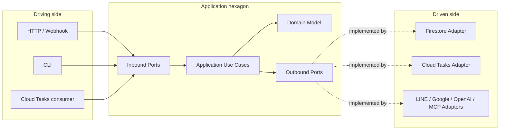
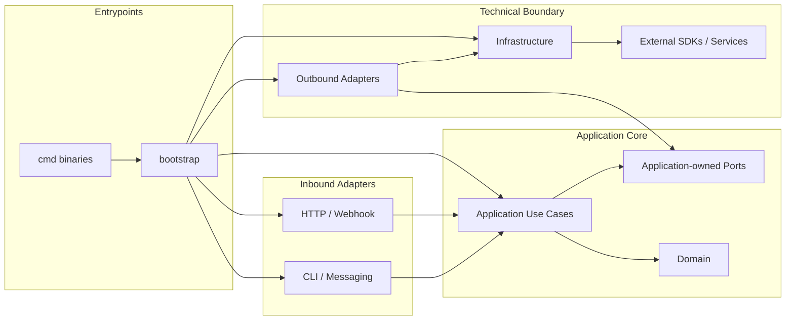
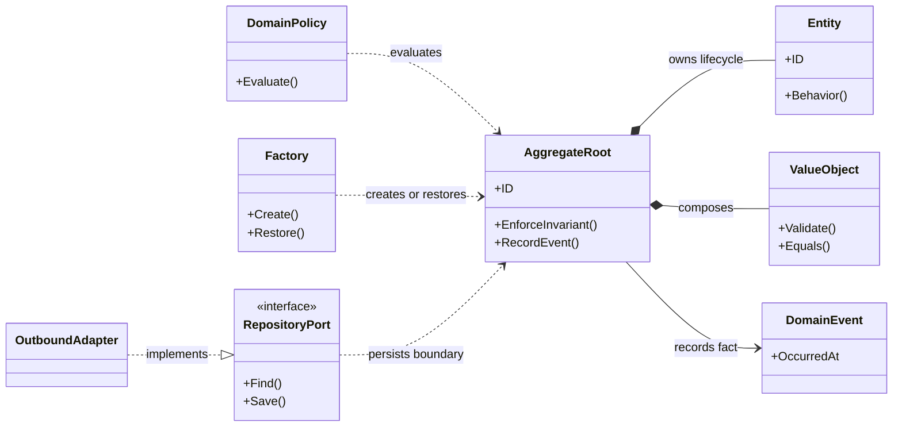
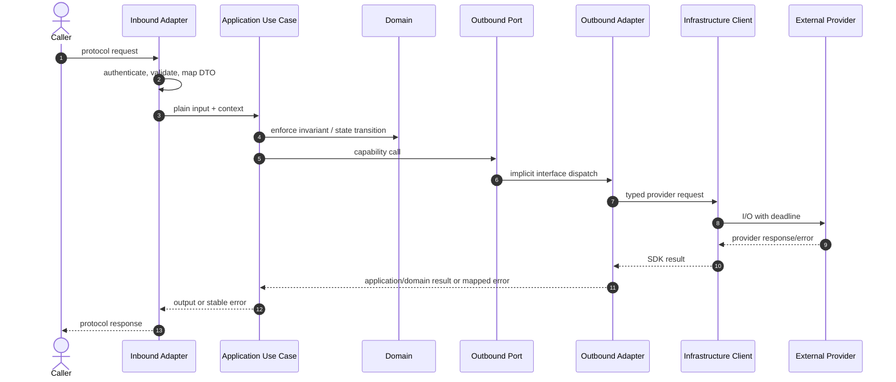
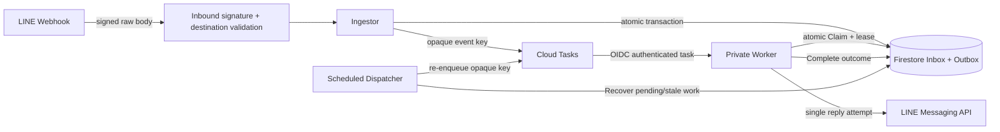
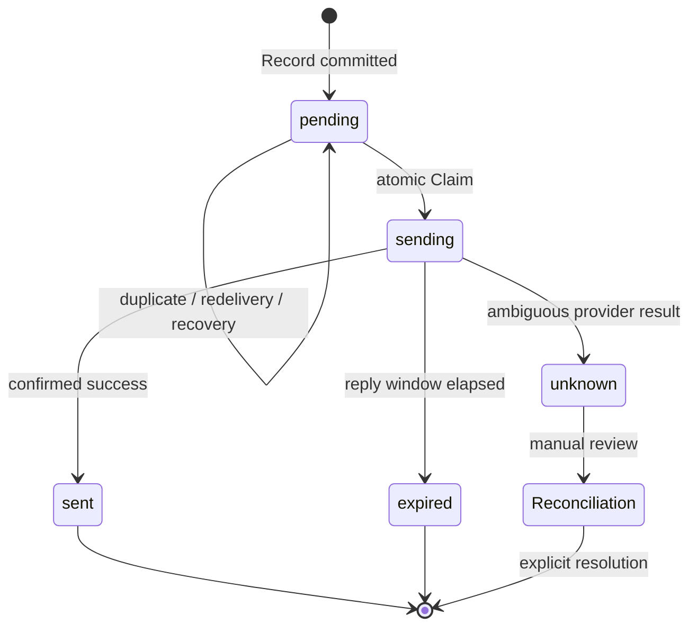
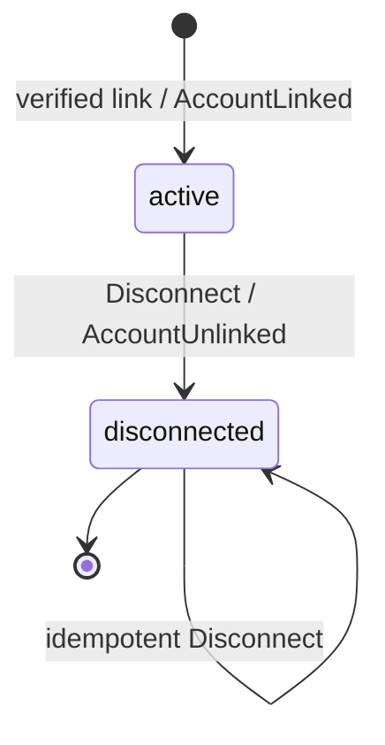

# DESIGN.md — Go DDD + Hexagonal Architecture 設計契約

本文件是本專案唯一的架構規範，包含目錄樹、分層責任、依賴、效能、命名與驗收規則。避免以另一份文件重複維護相同契約。

本設計以 `go.mod` 宣告的 Go 1.27.3 為基準，優先追求簡潔、明確、低 allocation 與可觀測性。Firestore、Cloud Tasks、Storage、Secret Manager、Google APIs/GenAI、LINE、OpenAI、MCP、HTTP、gRPC 與 OpenTelemetry 都是外部技術，必須隔離在 adapter/infrastructure。

設計目標是讓新能力沿既有邊界成長，而不是靠增加平行目錄、萬用介面或 Provider abstraction 擴張。非目標包括：為了套模板搬動無行為差異的 Package、預建所有 DDD 分類、以文件宣稱效能，以及將本服務的 `internal` Package 當成跨 repository 公開 API。

## 0. 標準目錄樹

```text
project/
├── cmd/
│   ├── api/main.go                         # HTTP/gRPC composition root
│   ├── worker/main.go                      # async task / event consumer root
│   └── migrate/main.go                     # schema/migration entry point
├── internal/
│   ├── domain/
│   │   ├── shared/                         # immutable primitives only
│   │   └── <bounded-context>/
│   │       ├── aggregates/                  # aggregate roots and consistency boundaries
│   │       ├── entities/                    # entities owned by aggregates
│   │       ├── value-objects/               # immutable values; package valueobjects
│   │       ├── events/                      # domain facts that already occurred
│   │       ├── factories/                   # complex creation and rehydration
│   │       ├── policies/                    # cross-entity business decisions
│   │       ├── specifications/              # composable business predicates
│   │       ├── repositories/                # minimal domain persistence contracts
│   │       ├── services/                    # domain services without a natural aggregate owner
│   │       └── errors.go                    # context-wide business errors, if needed
│   ├── application/
│   │   ├── ports/
│   │   │   ├── inbound/                    # shared external-to-application contracts
│   │   │   └── outbound/                   # shared app-required capabilities
│   │   └── usecases/<capability>/
│   │       ├── command.go                  # write behavior, when needed
│   │       ├── query.go                    # read behavior, when needed
│   │       ├── dto.go                      # application-owned data only
│   │       └── ports.go                    # single-consumer minimal interfaces
│   ├── adapter/
│   │   ├── inbound/{http,grpc,webhook,cli,messaging}/
│   │   └── outbound/
│   │       ├── {firestore,cloud_tasks,cloud_storage,secret_manager}/
│   │       ├── {google_api,google_genai,line,openai,mcp}/
│   │       ├── messaging/
│   │       └── in_memory/                  # tests and local development
│   ├── infrastructure/
│   │   ├── {config,http,grpc,clients,auth}/
│   │   ├── observability/                  # OpenTelemetry, logs, metrics
│   │   ├── concurrency/                    # bounded workers and shutdown
│   │   └── lifecycle/
│   └── bootstrap/{api,worker}.go           # dependency assembly only
├── api/{openapi,proto}/
├── migrations/
├── tests/{architecture,contract,integration,performance,e2e}/
├── go.mod
├── go.sum
└── README.md
```

此目錄樹是抽象藍圖，不代表每個 Bounded Context 必須建立全部分類目錄。分類目錄是責任邊界，不是預建 Scaffold；只有存在 production code、真實 consumer 與可驗收行為時才新增 Package。禁止只有 `.gitkeep`、type alias、空 interface 或轉呼叫 wrapper 的分類 Package。

`identity/` 是標準結構的實際範例：它依需求使用 `aggregates/`、`entities/`、`value-objects/`、`events/`、`factories/`、`policies/`、`specifications/` 與 `repositories/`。其他 Bounded Context 只能建立自身真正需要的分類，不得為了外觀完整複製整棵目錄樹。

### Package 成長閘門

新增 Package 前必須在變更說明回答：Owner 是哪個 Bounded Context／Capability、production consumer 是誰、獨立行為是什麼、為何不能留在既有 Package、允許的 imports 為何、由哪些測試驗收。缺少任一項時，預設不新增 Package。

可以拆分 Package 的證據包括：存在兩個以上獨立變更原因、同時承擔 Domain 與技術責任、測試單一行為需要建立大量無關依賴，或 consumers 已形成清楚群組。不得只因檔案數、行數、DDD 分類名稱或未來可能使用而拆分。

應合併或刪除的訊號包括：沒有 production consumer、只有 alias／空 interface／轉呼叫 wrapper、與另一 Package 共用相同語言和生命週期，或抽象沒有第二個實作及測試替身需求。

## 1. 分層責任

### Domain

`internal/domain/<bounded-context>/` 擁有 Aggregate、Entity、Value Object、Domain Service、Policy、Specification、Factory、Domain Event、業務錯誤與必要的 repository contract。各責任放在對應分類 Package，避免所有 Domain 型別任意堆入 context 根目錄，也避免把同一業務規則拆散到多個分類重複實作。

Domain 必須是純 Go：不可 import Application、Ports 的具體實作、Adapter、Infrastructure、ORM、資料庫或任何第三方 SDK。Aggregate 自己維護不變條件；Value Object 建立時驗證並保持不可變。

Context 內的依賴仍必須保持行為所有權：Aggregate 可以使用同一 context 的 Entity、Value Object 與 Domain Event；Policy、Specification 與 Factory 可以協作建立或判斷 Aggregate，但不得繞過 Aggregate 直接破壞狀態。Domain Service 只有在行為無法自然歸屬單一 Aggregate 時才建立。Repository Package 只放 Domain contract，不放 Firestore、SQL、序列化或 SDK 實作。

### Application

`internal/application/usecases/<capability>/` 組織 use cases，負責交易邊界、流程編排、Application DTO 與 application-level error mapping。它只能依賴 Domain 與最小的 consumer-owned ports。

Application 不得 import Firestore、gRPC、Google、LINE、OpenAI、MCP 或其他外部 SDK，也不得直接依賴具體 Adapter。

### Ports

`internal/application/ports/inbound/` 定義跨多個 inbound adapter 共用的 Application 契約；`internal/application/ports/outbound/` 定義多個 use case 共用的 repository、clock、publisher、task queue、identity 或 client capability。

Port 必須小型且由消費者需求定義，不 mirror 整份 SDK。若只有單一 use case 使用，Port 應放在 `application/usecases/<capability>/ports.go`；只有語意相同且由多個 use case 共用時才提升到 `application/ports`。Domain repository contract 回傳 Domain model 並表達 Domain persistence 語意；Application outbound port 表達工作流程或外部能力，兩者不得重複同一 contract。

### Adapters

Inbound adapters 負責 HTTP、gRPC、webhook、CLI、message protocol 的解析、驗證、mapping 與呼叫 use case；不得繞過 Application 修改 Domain 或資料庫。

Outbound adapters 實作 ports，負責 SDK request/response、序列化、錯誤映射、retry、timeout、pagination、batch 與 transaction。Persistence model 與 Domain model 分離，mapping 屬於 adapter。

### Infrastructure / Bootstrap

Infrastructure 管理 config、server、client lifecycle、OAuth/token source、gRPC keepalive/interceptors、OpenTelemetry、worker concurrency、readiness 與 graceful shutdown。它不承載業務政策。

`cmd/*/main.go` 與 `internal/bootstrap/` 只負責 composition root：建立長壽命 client、具體 adapter、use case 與依賴注入。

### Hexagonal Architecture 視圖



左側 Adapter 驅動 Inbound Port；右側 Adapter 實作由 Application 擁有的 Outbound Port。圖中的 runtime 呼叫方向可以向外，但 Go import 必須朝核心反轉：Adapter import Port，Port 不 import Adapter。

## 2. 唯一依賴方向



箭頭表示 compile-time import 或 composition dependency。Runtime 呼叫可沿 Port 從 Application 到 Adapter，但 source dependency 仍由 Adapter 指向 consumer-owned Port。

強制規則：

- Domain 不得反向依賴 Application、Adapter、Infrastructure 或 SDK。
- Application 不得 import 具體 outbound adapter、client factory 或 SDK。
- Adapter 以 Go implicit interface 實作 port；port 不得 import adapter。
- Infrastructure 可依賴 SDK，但不可把 SDK 型別穿透到 Domain/Application。
- Infrastructure 不得 import Application use case、Domain Policy 或 Adapter；它提供可被 Adapter／Bootstrap 組裝的技術 client、transport 與 lifecycle primitive。
- Inbound Adapter 不得直接 import outbound Adapter、persistence 或 provider client。
- 跨 bounded context 必須經由明確的 port、DTO 或 domain event，不共享可變 domain model。
- 禁止循環 import；任何例外必須先重新設計邊界。

## 3. DDD 與高內聚

1. 以 bounded context 分隔語言、aggregate 與業務規則；`shared/` 只放真正穩定的 immutable primitives。
2. Repository contract 放在使用它的 Domain/Application 邊界，實作放 outbound adapter；不得同時維護重複 contract。
3. Domain Event 表示已發生的業務事實；可靠發布需透過 transaction + outbox 或等價機制。
4. Policy、Specification、Factory 只在有獨立業務行為時建立，不用分類名稱製造空 Package。
5. 簡單 CRUD 不強行套用 Aggregate、CQRS 或大量 DTO；架構重量應與 domain complexity 成比例。
6. `pkg/` 只有在確定有外部 module 使用時才建立；其餘程式放 `internal/`。
7. 新增分類 Package 前必須指出 owner、consumer、業務行為與測試；不得以 DDD 名稱本身作為建立理由。
8. `value-objects/` 的 import path 保留連字號，Go package 名稱固定為 `valueobjects`；不得另建 `valueobjects/` 或 `value_objects/` 平行目錄。
9. 同一業務規則只能有一個 owner，不得同時由 Aggregate、Policy、Application 與 Bootstrap 各自判斷。
10. 跨 bounded context 必須使用明確 Port、DTO 或 Domain Event，不直接共享或修改另一 context 的 Aggregate／Entity。

### DDD Tactical Building Blocks



Aggregate 是 transaction consistency boundary；Entity 不能脫離其 Aggregate 被任意修改，Value Object 以值與不變性表達概念。Factory 只處理複雜建立或還原，Repository Port 以 Aggregate 為讀寫單位，技術 Adapter 不參與業務決策。

## 4. 命名邏輯

| 對象 | 命名規則 | 範例 |
| --- | --- | --- |
| Package | 小寫、簡短、無底線，以責任而非技術流行語命名 | `ingestion`, `workspace`, `firestore` |
| 檔案 | `snake_case.go`，以主要行為或能力命名 | `authorize_account.go` |
| Aggregate／Entity／Value Object | 使用 Ubiquitous Language 的業務名詞 | `AccountLink`, `GoogleConnection` |
| Use Case | 動詞＋受詞 | `AuthorizeLinkedGoogleAccount` |
| Command／Query | 寫入與讀取語意明確，不用萬用 `Request` | `DisconnectAccount`, `InspectChannel` |
| Port | 以消費者需要的能力命名 | `EventStore`, `EventQueue`, `Messaging` |
| Adapter | Provider＋能力，由 package path 表達 provider | `firestore.Store`, `cloudtasks.Queue` |
| Constructor | 新建使用 `NewX`；持久化還原使用 `RestoreX` | `NewAccountLink`, `RestoreAccountLink` |
| Domain Event | 使用已發生的過去式 | `AccountLinked`, `AccountUnlinked` |
| Error | 使用穩定語意，不暴露 provider 細節 | `ErrEventTooOld` |
| Boolean | 使用 `Is`、`Has`、`Can`、`Should` | `IsActive`, `CanUseGoogleAPI` |

縮寫遵循 Go 慣例，統一使用 `ID`、`URL`、`HTTP`、`API`、`OAuth`。禁止同一概念交替使用 `Manager`、`Service`、`Provider`、`Client`；`Client` 僅指外部 SDK／transport client，`Service` 僅用於有獨立 Domain 或 Application 行為的元件。

## 5. 同步流程與資料邊界



Inbound 負責 protocol authentication、大小限制、解析與 DTO mapping；Application 負責流程、授權與 transaction boundary；Domain 負責不變條件；Outbound Adapter 負責 provider mapping 與錯誤轉換。任何層不得把 SDK response、Firestore snapshot、HTTP request 或 credential 傳入 Domain。

## 6. Durable Event／Outbox 流程



Webhook redelivery、duplicate task name 與 dispatcher recovery 都必須保持冪等。Firestore transaction 只保證 Inbox／Outbox 內部原子性，不代表 Firestore 與 Cloud Tasks 或 LINE API 之間 exactly-once。外部發送結果不明時不得自動重送。

### Event Aggregate 狀態圖



`sending` 與 `unknown` 禁止自動回到 `pending`，因為 timeout 可能代表 LINE 已接收訊息。狀態名稱必須與 `application/ports/outbound.EventState` 保持一致。

### AccountLink Aggregate 狀態圖



`RestoreAccountLink` 只還原既有狀態，不產生新 Domain Event。OAuth credential、Firestore version 與 encryption metadata 不屬於 Aggregate。重新連結必須建立經驗證的新連結流程，不得直接把 disconnected instance 改回 active。

## 7. 技術 adapter 與效能契約

### Client lifecycle

- Firestore、Storage、Secret Manager、Cloud Tasks、Google API、GenAI、LINE、OpenAI 與 MCP client 在啟動期建立並重用；request handler 不重建 client。
- gRPC 重用 `ClientConn`，依服務設定 deadline、keepalive、interceptor 與 stream cancellation；每個 stream 必須由 context 取消或正常讀完以避免資源洩漏。
- 同一個 client 是否可共享，必須以 SDK thread-safety 與認證 scope 判定；帶使用者 OAuth 狀態的 TokenSource/HTTP client 不得跨使用者共享。

### Data access

- Firestore query 必須有明確的 limit、cursor pagination 與必要 index；避免 offset pagination 與 N+1 reads。
- 批次寫入使用 batch；需要條件一致性時使用 transaction，並以 context deadline 終止重試。
- Firestore iterator／snapshot listener 必須由 context deadline、`Stop` 或完整讀取結束；不能遺留背景 stream。Transaction callback 必須可安全重試，不在 callback 內執行不可重複的外部副作用。
- Repository 對 Domain 隱藏 document schema、SDK snapshot 與 transport error；只回傳 domain/application 可理解的結果。

### Concurrency

- Worker 使用 bounded concurrency、backpressure、idempotency key 與 graceful shutdown。
- 不以無界 goroutine、全域 mutable state 或過度快取換取吞吐量。
- 所有外部操作傳遞 context；不將 context 儲存在長壽命 struct。

### Performance discipline

優先量測 database latency、network round trips、serialization、allocation、GC、lock contention、queue depth 與 cache hit rate，再進行優化。分層本身不是效能證明；避免無意義的 wrapper、DTO 轉換與重複 client 建立。

## 8. Go 實作與依賴規則

- 單一根 Go module；版本由 `go.mod` 管理，`go mod tidy` 保持依賴最小且可重現。
- `go.mod` 的 direct dependencies 必須對應已實作的 adapter/infrastructure、建置工具或經明確核准的固定邊界；版本、用途與狀態由 SDK Catalog 記錄。新增 SDK 前先確認官方 package 能否直接滿足需求，禁止建立動態 provider router 包裝多個無關 SDK。
- 本服務不提供跨 repository Go library API；程式預設放在 `internal/`。只有確定被外部 module 使用並承諾相容性時才建立 `pkg/` 或拆出獨立 module。
- Package 名稱小寫、簡短、不使用底線；檔案使用 `snake_case.go`；公開型別使用 `MixedCaps`。
- Constructor 顯式回傳具體型別與 error；不用 Service Locator、反射式 DI 或泛型大工廠。
- 官方 SDK 的 client、constructor、options、request/response 與 webhook 驗證直接重用；只有重複的 lifecycle/configuration 才建立 provider-specific factory。
- Factory 只建立技術 client，不執行 Domain Policy、授權決策或 Token 持久化。

## 9. 測試與驗收

- Domain：純 Go unit tests，驗證 aggregate、value object、不變條件與 domain events。
- Application：fake outbound ports 測試 use case、交易與錯誤流程。
- Adapter：contract tests；Firestore、gRPC、Cloud Tasks、外部 API 使用 integration tests。
- System：`tests/e2e` 驗證 inbound adapter 到外部資源的完整流程。
- Performance：`tests/performance` 使用 benchmark、load test 與 profiling，不能只由目錄結構推論高效能。

| 變更 | 最低驗收 |
| --- | --- |
| Domain invariant／state | Domain unit tests、architecture tests |
| Application use case／Port | Fake-based use-case tests、interface implementation check |
| HTTP／Webhook／CLI | Handler tests、contract tests、錯誤與大小限制 |
| Firestore／Cloud Tasks | Contract tests、race、integration compile；真實交易需 Emulator／staging 證據 |
| OAuth／Identity | replay、expiry、PKCE、nonce、ownership、scope、encryption/CAS tests |
| Worker／Concurrency | cancellation、retry、idempotency、graceful shutdown、race tests |
| SDK upgrade | module source／Context7 查證、adapter contract tests、client lifecycle revalidation |
| Performance claim | 可重現 benchmark/profile 與變更前後基準 |

依變更風險執行 `gofmt`、`go test ./...`、`go vet ./...`、`go build ./...`；涉及 race、persistence、OAuth 或 worker concurrency 時，再加入 `go test -race ./...` 與整合測試。

若 gopls MCP 可用，可用於 definition、references、implementations 與 diagnostics；不可用時明確標示 `gopls MCP unavailable`，改用 Go CLI 工具，不得聲稱已使用 gopls。

## 10. 架構變更流程

任何新增 Bounded Context、跨層 dependency、共享 Port、外部 SDK 或 persistence schema 的變更，依序執行：

```text
需求與 Ubiquitous Language
→ Owner／Consumer／Invariant
→ Port 與資料契約
→ gopls definitions／references／implementations
→ 最小可編譯 slice
→ focused tests
→ architecture／contract／race gates
→ reviewer(architecture,testing,security)
```

架構決策若改變本文件的穩定規則，先新增 ADR，說明 context、decision、alternatives、consequences 與 rollback，再更新本文件。只有歷史背景放 ADR；目前有效規則只保留在 `DESIGN.md`。

Definition of Done：沒有未知 import drift、沒有重複 business owner、沒有 SDK 型別穿透、沒有未關閉 resource、沒有未說明的外部 contract 變更；所有實際執行命令與未驗證環境均明確記錄。

## 11. 文件與工具設定

`AGENTS.md` 負責工作流程與角色路由；`.codex/config.toml` 只負責 MCP 連線設定，不是架構規範。任何文件更新不等於程式已重構、測試已通過或服務已部署；交付時必須分別回報文件變更、實際程式驗證與未驗證項目。

Mermaid 圖表是可讀視圖，文字規則與 architecture tests 才是可執行契約。狀態圖中的名稱必須對應程式常數；資料流程中的安全、重試、transaction 與 authorization 邊界必須有測試或明確標記 `Not Verified`。

