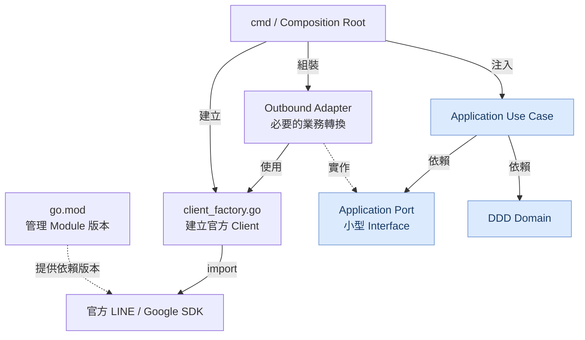

# DESIGN.md — Go DDD + Hexagonal Architecture 設計契約

> 適用範圍：本儲存庫所有 Go 程式、SDK 整合、CI 與未來擴充。這是架構規範，不代表目前所有功能已完成。維持 Pragmatic DDD、Lightweight Hexagonal Architecture 與 Idiomatic Go；不為形式製造額外 Wrapper 或 Package。

## 1. 不可退化原則

1. **DDD 邊界**：Domain 管理業務不變條件、Aggregate、Entity、Value Object、Policy、Specification、Factory、Repository 契約及 Domain Event；不依賴外部 SDK。
2. **依賴方向**：Source-code imports 朝向 Domain / Application 契約；具體 SDK 與資料庫實作位於外側。
3. **SDK 優先重用**：官方 SDK 已提供的 Client、Constructor、Options、HTTP Transport、API Request/Response、Webhook 驗證與 OAuth 元件，直接重用；只有跨越業務邊界、必要的安全控制或重複初始化才新增程式。
4. **Go Idioms**：單一 Go Module、明確建構、組合優於繼承、小型消費者導向介面、context 傳遞、顯式錯誤；避免全域 Service Locator、DI Framework 與沒有行為的 Wrapper。
5. **最小必要變更**：保留既有加密資料、Firestore 文件識別、Token Refresh CAS、OAuth 安全規則與公開 API 契約。重構必須以測試證明相容。
6. **保留 Identity DDD 分類**：不得為了減少 Package 數而擅自合併下述八個目錄。

## 2. Module、Package 與 SDK：三個不同概念

- 根目錄 `go.mod` 定義 **一個 Go Module**（`github.com/963sup/linebot-platform`）及版本依賴；`go.sum` 保存模組校驗資訊。
- `import` 使用 **Package 路徑**，例如 `google.golang.org/api/calendar/v3`；多個 Package 可以來自同一個 Module `google.golang.org/api`。
- SDK Package 是第三方已存在的程式庫，**不是**專案需要另外建立的中介層。
- `internal/` 包含專案私有 Package；`cmd/` 是可執行入口。不要為每個 Domain 或 SDK 建立第二個 `go.mod`，除非確實需要獨立發布與版本生命週期。
- `go mod tidy`、`go list -m all`、`go list -deps ./...` 用於核對依賴。直接／間接依賴的分類依 Go Module Graph 與實際 Package imports 判定；不可把未使用的 SDK 宣稱為正在執行的能力。
- `docs/sdk/catalog.toml` 可記錄「使用中／已核准預留／規劃中」，與 `go.mod` 的現有直接依賴分開理解。現有 retention gate 的預留策略在另行授權修改前必須維持；未來若調整，應連同 CI 與 Catalog 一起修改，不可暗中刪除依賴。

### 已使用或預留的 Module 與 Package 對應

| Go Module | 官方 Package 範例 | Factory / 使用位置 |
| --- | --- | --- |
| `github.com/line/line-bot-sdk-go/v8` | `linebot/messaging_api`, `liff`, `channel_access_token`, `insight`, `manage_audience`, `module`, `module_attach`, `shop` | `internal/infrastructure/line/client_factory.go` 及必要的授權元件 |
| 同上 | `linebot/webhook`, `linebot/httphandler` | Inbound HTTP Adapter；不是 Outbound Client Factory |
| 同上 | `linebot` | 依實際 SDK 功能直接 import；不為根 Package 創造空 Wrapper |
| `golang.org/x/oauth2` | `oauth2`, `oauth2/google` | OAuth Flow / TokenSource，使用者授權 HTTP Client |
| `google.golang.org/api` | `idtoken`, `oauth2/v2`, `option`, `calendar/v3`, `tasks/v1`, `forms/v1` | Identity Verifier / Google Client Factory |
| `cloud.google.com/go/firestore` | Firestore SDK | Firestore Adapter / Client 建立 |
| `cloud.google.com/go/cloudtasks` | Cloud Tasks SDK | Cloud Tasks Adapter / Client 建立 |

同一 Provider 的不同 API Family 可能需要不同 Constructor、認證選項與權限；**統一入口不等於強迫所有 API 具有相同簽章**。

## 2A. 從 go.mod 到 client_factory.go：最短依賴路徑（Context7 / Go 官方查證）

**結論：go.mod 不會直接呼叫 Factory。** `go.mod` 只記錄 Module 與版本；Factory 的 `import` 才是對官方 SDK Package 的編譯期依賴。不要再建立專案自有的「SDK Package Layer」。

```text
go.mod: require github.com/line/line-bot-sdk-go/v8 v8.23.0
    └── infrastructure/line/client_factory.go
          import "github.com/line/line-bot-sdk-go/v8/linebot/messaging_api"
          return messaging_api.NewMessagingApiAPI(token, options...)

go.mod: require google.golang.org/api v0.310.0
    └── infrastructure/google/api/client_factory.go
          import "google.golang.org/api/calendar/v3"
          return calendar.NewService(ctx, options...)

go.mod: require golang.org/x/oauth2 v0.37.0
    └── OAuth 授權元件
          import "golang.org/x/oauth2"
          建立使用者專屬 TokenSource / 已授權 HTTP Client
```

版本是本 PR 查核時的現有值，非要求未來固定不升級。這裡是**版本宣告 → import → 官方 Constructor** 的關係，不是 Runtime 呼叫堆疊。

### 選擇規則（依序套用，避免重複封裝）

| 條件 | 應採做法 | 不應做法 |
| --- | --- | --- |
| 官方 Constructor 只呼叫一次，沒有共用設定 | 在 Composition Root 直接呼叫官方 Constructor | 為了命名一致新增單行 Factory Wrapper |
| 同 Provider 多個 Client 共用設定、HTTP Transport 或驗證 | 集中至一個 `client_factory.go`，提供簡短、具體的 `NewX` | 每個 API 都建立 `client.go`、`builder.go`、`provider.go` 三層 |
| 官方 SDK 已有 Request / Response / API 操作 | Adapter 直接使用 SDK 型別與方法；只有跨 Application Port 邊界才轉換資料 | 複製整份 SDK DTO 或重新封裝所有 API 方法 |
| Client 依使用者授權不同 | Factory 接收已授權 `TokenSource` 或 HTTP Client，按需建立 | 全域快取帶有單一使用者 Token 的 Client |
| Webhook 解析、驗簽已有官方功能 | Inbound Adapter 直接使用官方 Webhook / HTTP Handler | 再寫一套簽章驗證與事件解析 |
| SDK 建立與業務授權混在一起 | 授權決策留在 Application / Domain，Factory 只建立 Client | 在 Factory 查 Firestore 或執行 Domain Policy |

### 官方 SDK Constructor 直接重用範例

LINE（同一個 Provider Factory 內可提供 Messaging、Blob、Insight、Audience 等**必要**的建立函式）：

```go
// infrastructure/line/client_factory.go
func NewMessagingClient(token string, httpClient *http.Client) (*messaging_api.MessagingApiAPI, error) {
    if strings.TrimSpace(token) == "" || httpClient == nil {
        return nil, errors.New("LINE token and HTTP client required")
    }
    return messaging_api.NewMessagingApiAPI(token, messaging_api.WithHTTPClient(httpClient))
}
```

Google（以**已授權**的 HTTP Client 作為輸入；其他服務同理）：

```go
// infrastructure/google/api/client_factory.go
func NewCalendar(ctx context.Context, authorizedHTTP *http.Client) (*calendar.Service, error) {
    if ctx == nil || authorizedHTTP == nil {
        return nil, errors.New("context and authorized HTTP client required")
    }
    if err := ctx.Err(); err != nil {
        return nil, err
    }
    return calendar.NewService(ctx, option.WithHTTPClient(authorizedHTTP))
}
```

上面範例只展示必要函式本體，實際檔案仍需正常 import。Google 的 `authorizedHTTP` 必須由該使用者的 OAuth TokenSource 建立（例如 `oauth2.NewClient(ctx, source)`）；不可用未授權的普通 HTTP Client 取代。**同一個已授權 HTTP Client 可以供該使用者的多個 Google Service 使用，不得跨使用者共用認證狀態。**

### 依賴方向的精確解讀

依賴關係的**唯一規範圖、箭頭語意、import 矩陣與建立／執行流程**統一參考第 3 節，不再在其他章節維護第二份可能衝突的架構圖。

### 針對本 PR 的最小重構邊界

- 保留 `internal/domain/identity/` 的八個 DDD 分類，不以這次 Factory 收斂為理由更動。
- 現有 `internal/infrastructure/line/client_factory.go` 已有 Messaging / Blob Constructor；可評估把 `audience_client.go`、`insight_client.go` 等重複初始化**整合到同一 Package / Factory 入口**，但不強制合併檔案。
- 現有 `internal/infrastructure/google/api/client_factory.go` 已有 Calendar、Tasks、Forms、Drive、Sheets Constructor；**優先直接重用**，而不是再建立一個泛用 `ClientFactory` Struct 包住同一批函式。
- 不要同時維護 `NewCalendar`、`Factory.Calendar`、`NewWorkspaceCalendarClient` 三種功能等價的入口。
- `bootstrap/workspace.go` 仍可負責組裝；若要減碼，先量測並消除重複建立與配置，不是把組裝責任搬到 Domain 或 Factory。
- 本文件只建立標準；是否達到 40% 減碼率，需以重構前後有效程式行數驗證。

**查證依據（Context7）：** Go 官方 `go.dev/doc/code`、`go.dev/doc/modules/layout`、`go.dev/doc/modules/managing-dependencies` 說明 Module 與 Package 的關係及 `go mod tidy`；LINE 官方 `line-bot-sdk-go` 文件展示 `NewMessagingApiAPI` 與 `WithHTTPClient`。Google Factory 實例則依本儲存庫現有的官方 SDK `NewService` 呼叫整理，未聲稱 Context7 找到完整 Google Go Client 條目。

## 3. 依賴方向：統一圖與實作契約

下圖是本專案的**概念關係圖**，沿用既定的節點與標籤；它同時呈現版本管理、原始碼 import、物件建立與 Port 實作關係，因此**不可把所有箭頭當成同一種 import 或執行期呼叫**。



### 3.1 圖中每一種箭頭的精確語意

| 圖中關係 | 實際語意 | Go 程式碼依賴方向 |
| --- | --- | --- |
| `go.mod → SDK` | Module 版本解析，不是 runtime 呼叫 | `go.mod` 的 `require` 宣告 |
| `Factory → SDK` | Factory 直接 import 官方 Package 並呼叫 Constructor | `infrastructure → SDK` |
| `cmd → Factory` | Composition Root 建立 Client | `cmd → infrastructure` |
| `cmd → Adapter / Use Case` | 手動 Constructor Injection | `cmd → adapter / application` |
| `Adapter → Factory` | **可選**：Adapter 需要延遲建立使用者專屬 Client 時呼叫 Factory | `adapter → infrastructure`；一般情況由 `cmd` 建好 SDK Client 再注入 Adapter |
| `Adapter → Port` | Adapter 實作 Port 的契約（圖中的虛線不是 runtime 呼叫） | Adapter 可 import Port / Domain 型別；Port **不得** import Adapter |
| `Use Case → Port` | Use Case 呼叫注入的 Port | `application/usecase → application/port` |
| `Use Case → Domain` | Use Case 執行領域模型與規則 | `application → domain` |

**重要：** 上圖的 `AD → F` 是可選關係，不是強制多一層。若 Factory 只在啟動時使用，Adapter 只持有已注入的官方 SDK Client。若 Factory 用於每位使用者 OAuth Client 的按需建立，Adapter 可以持有一個具體 Factory 或所需的最小建構能力；但 Domain / Application 不能 import Factory。

### 3.2 強制 import 依賴矩陣

```text
cmd/{webhook,worker,ops} [Composition Root]
    ├── application/usecases
    ├── adapter/inbound
    ├── adapter/outbound
    └── infrastructure/{line,google,...}

adapter/inbound ───────────> application/usecases / inbound ports
application/usecases ──────> domain + application outbound ports
adapter/outbound ──────────> application ports + domain (必要時) + SDK / infrastructure
infrastructure ────────────> 官方 SDK + Go 標準函式庫 + 技術元件
domain/identity/* ────────> domain/identity/* + Go 標準函式庫
```

- **禁止** Domain import Application、Adapter、Infrastructure、LINE / Google / Firestore SDK。
- **禁止** Application Use Case import 具體 Outbound Adapter、Client Factory、Infrastructure SDK。
- Port 是由 Application 或 Domain 擁有的契約；Outbound Adapter 實作 Port，Port 不反向 import Adapter。
- Inbound Adapter 驗證外部輸入並呼叫 Use Case；不可繞過 Application 執行業務授權或直接改寫 Domain 持久化。
- Infrastructure Factory 只處理官方 SDK 建立與技術設定；不查詢 Domain Policy、不持久化 OAuth Token、不做使用者授權決策。
- `cmd/` 是 Composition Root；`internal/bootstrap/` 僅在多個入口確實共用組裝時保留。兩者都不得承擔業務政策。
- Domain 八個子 Package 需避免循環 import；保留目錄分類不代表每個流程必須穿過所有分類。
- Adapter 使用 SDK 的 Request / Response 型別時可以直接 import 官方 SDK；不為了「單一 import 位置」製造一比一 Facade。

### 3.3 建立期與執行期分離

```text
版本解析：go.mod ──require──> 官方 SDK Modules
原始碼：Factory ──import──> 官方 SDK Packages

建立期：cmd / 可選 bootstrap ──> Factory / 官方 Constructor
                              └──> Adapter ──注入──> Use Case

執行期：Webhook / HTTP → Inbound Adapter → Use Case
        → Domain 規則 + Port → 已注入的 Outbound Adapter → SDK Client → 外部 API
```

Port 在執行期是介面分派的契約，**不是**一個獨立的中繼服務。Factory 通常不在執行期請求路徑中；使用者專屬 Google Client 需要延遲建立時才例外。

## 4. Domain / Identity：固定目錄與命名

```text
internal/domain/identity/
├── aggregates/account_link.go
├── entities/google_connection.go
├── value-objects/
│   ├── line_user_id.go
│   ├── google_account_id.go
│   ├── connection_id.go
│   ├── oauth_scope.go
│   └── connection_status.go
├── policies/
│   ├── linking_policy.go
│   └── unlinking_policy.go
├── specifications/connection_eligibility.go
├── factories/connection_factory.go
├── repositories/connection_repository.go
└── events/
    ├── account_linked.go
    └── account_unlinked.go
```

- 目錄名稱保留 `value-objects/`；Go package 識別字為 `valueobjects`，import 時可用別名。
- Aggregate Root `AccountLink` 控制一致性與狀態轉換；`GoogleConnection` 是 Aggregate 內的 Entity，不得形成平行的授權真相。
- Value Object 驗證資料、封裝不變性；不得依賴 OAuth SDK。
- Policy / Specification 封裝可測試的純業務規則；Factory 建立／還原有效模型。**分類目錄必須保留，但禁止製造重複的業務判斷或無意義轉接**。
- Repository Interface 定義 Domain 所需能力，具體 Firestore 實作在 Adapter；可另用 Application consumer-owned 小介面處理 Token Store 等技術需求。
- Domain Event 在狀態變更時記錄；只有持久化成功後才能對外發布。若需要可靠交付，必須另行設計 Outbox。
- LINE User ID 必須來自已驗證身分；Google Account ID 應使用已驗證的 Google `sub`，不是 Email。

## 5. Client Factory 標準：直接重用官方 SDK

### 5.1 一個 Provider 一個主要 Client Factory

- `internal/infrastructure/line/client_factory.go`：集中 LINE Messaging、Blob、LIFF、Insight、Audience、Module、ModuleAttach、Shop 等**實際需要**的官方 Client 建立；Token 管理由授權元件負責。
- `internal/infrastructure/google/api/client_factory.go`：集中 Google UserInfo、Calendar、Tasks、Forms，以及專案已使用的 Drive、Sheets 官方 `NewService`；只建立需要的 Client。
- 其他 SDK（Firestore、Cloud Tasks 等）只有多處初始化或需要共用生命週期時才建立 Factory，否則直接使用官方 Constructor。
- Factory 應回傳官方 Client 具體型別及 error，不建立一比一的 `SDKClientWrapper`、`Manager`、`Provider`、`Builder`。
- 不為所有 Factory 建立 Interface；只有消費端需要替換能力（例如測試）才定義最小介面。
- 共用 Transport、Timeout、Retry、Logger、Client Options 與配置驗證；不要在多個 Adapter 重複初始化。
- 不使用反射、Service Locator、泛型大工廠或字串驅動的 API Client 選擇器。SDK Constructor 不同時，以簡短且明確的方法保留差異。
- Factory 不呼叫 Domain Policy，不持久化 Token，不決定使用者是否獲授權；這些分別由 Application、OAuth 元件與 Adapter 管理。

### 5.2 LINE 依賴例

```text
go.mod require github.com/line/line-bot-sdk-go/v8
infrastructure/line/client_factory.go --import--> linebot/messaging_api
cmd --建立 Client 並注入--> adapter/outbound/line
adapter/outbound/line --實作--> application outbound port
```

Webhook / httphandler：`SDK → adapter/inbound/http/line → Application`；不得硬塞入 Outbound Factory。

### 5.3 Google 依賴例與使用者隔離

```text
go.mod require golang.org/x/oauth2 + google.golang.org/api
已驗證 LINE principal / Google OAuth state、PKCE、nonce → 使用者專屬 TokenSource
infrastructure/google/api/client_factory.go --import--> calendar/v3、option
Factory 使用已授權 HTTP Client 呼叫 calendar.NewService(...)
cmd / 授權後的 Adapter --建立與注入--> calendar outbound adapter
calendar outbound adapter --實作--> application outbound port
```

Tasks / Forms / UserInfo 使用各自官方 `NewService`；不需另外建立一層「SDK Package」。

**認證安全**：
- Google 使用者的 Calendar / Tasks / Forms 不得使用 Cloud Run Service Account / ADC 取代使用者 OAuth。
- `option.WithHTTPClient(client)` 必須收到**已授權**的 HTTP Client；若使用 `option.WithTokenSource(source)`，不得又傳入會覆蓋認證行為的普通 HTTP Client。
- 每個使用者的 TokenSource / 認證 HTTP Client 必須隔離；可以共用安全的底層網路資源，但不可跨使用者共用授權狀態。
- 授權 scopes、owner/subject、active 狀態由 Application + Domain 驗證；Factory 只接收已授權的建立參數。
- Token Refresh 必須安全持久化、保留 CAS/transaction 保護，避免多個 Cloud Run 實例競爭。
- 不在 Domain、Log、URL 中保存 Access Token / Refresh Token；Firestore 既有加密 JSON、文件 ID、版本欄位與相容性契約不可擅改。

## 6. 組裝入口與命名一致性

- `cmd/<process>/main.go` 是合法 Composition Root；當 webhook / worker / ops 有**實際共用**的組裝流程時，可保留 `internal/bootstrap/`，但不要求每個功能必經 Bootstrap。
- `client_factory.go`：Provider 層集中建立官方 SDK Client。
- `*_adapter.go` 或業務命名檔案：外部能力轉換、錯誤映射與 Port 實作；不再重複 SDK Constructor。
- `*_repository.go`：持久化契約或實作，依所在 Layer 判定；不可用 Repository 名稱掩蓋純 SDK API 呼叫。
- `*_policy.go`：業務決策；`*_factory.go`（Domain）：領域物件建立；兩者不得與 Infrastructure Client Factory 混淆。
- Go Package 名稱簡短、小寫、無底線；檔案採 `snake_case.go`；型別使用 `MixedCaps`；公開 API 名稱描述行為，不重複 Package 名稱。
- 依賴注入優先使用 `NewX(deps...)`；Context 不保存於長壽命 Struct，應於請求／操作方法傳遞。
- 相同邏輯只存在一處；禁止為符合檔案樹而製造重複 DTO、Mapper、Interface 或 Wrapper。

## 7. 變更流程與 CI 驗收

1. 從 `go.mod` 核對 Module 及版本，查官方 SDK Package / Constructor / Options；先確認是否已提供所需功能。
2. 搜尋現有 `client_factory.go` 與 Adapter，重用既有初始化；只在缺少實際能力時擴充 Factory。
3. 定義必要的 Application Port 與 Domain 規則，檢查 import 方向；保留 Identity 八個分類目錄。
4. 用手動 Constructor Injection 組裝；不要建立無效的 Bootstrap 轉接層。
5. 檢查 OAuth、LINE Webhook 驗證、Firestore 相容性、Token Refresh CAS 與使用者隔離。
6. 執行 `gofmt`、`go vet ./...`、`go test ./...`、`go test -race ./...`、`go build ./...`、`go mod tidy` 並檢查 `git diff -- go.mod go.sum`。依現有 CI 保留已授權的 SDK retention 規則。
7. 架構測試應檢查 Domain / Application 禁止 import 的依賴、循環依賴與業務不變條件；不要把檔案數量或 Wrapper 數量當成品質指標。
8. 若以減少 40% 以上程式碼為目標，先定義量測範圍：**SDK 初始化與組裝的專案自有有效程式行數**。比較重構前後，排除第三方 SDK、註解、空白、測試與 Domain 業務邏輯；不得未量測就宣稱達標。

## 8. 參考與驗證界限

- Go 官方 Module Layout：https://go.dev/doc/modules/layout
- Go Module Reference：https://go.dev/ref/mod
- Go Code Review Comments：https://go.dev/wiki/CodeReviewComments
- LINE SDK：https://github.com/line/line-bot-sdk-go
- Google API Go Client：https://github.com/googleapis/google-api-go-client

Go 官方沒有強制規定 DDD／Hexagonal 的唯一目錄結構；本文件是本儲存庫採用的架構契約。文件更新不等於已完成程式重構、Firestore Emulator 驗證、OAuth 外部驗證或 Cloud Run 部署。
