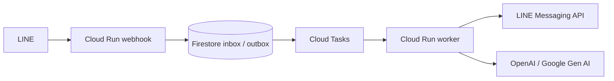

# linebot-platform

使用 **Go**、**Domain-Driven Design (DDD)** 與 **Hexagonal Architecture（Ports & Adapters）** 建置的 LINE Messaging API 平台，預計運行於 Google Cloud Run，並可選配 OpenAI、Google Gen AI（Gemini）及 Google API。

> **狀態：僅完成規劃與目錄骨架（scaffold）。** 尚無可執行的 Go Bot、LINE webhook、AI 串接、CI 或正式部署。所有 `.gitkeep` 都代表預留位置，**不是已實作功能**。

## 目標架構

- `cmd/webhook`：公開 Cloud Run webhook 入口（待實作）
- `cmd/worker`：Cloud Tasks 驗證後呼叫的私有背景工作服務（待實作）
- `cmd/ops`：需授權的管理 CLI / Cloud Run Job（待實作）
- `internal/domain`：業務規則、聚合、值物件與 repository 契約
- `internal/application`：commands、queries、use cases 與 ports
- `internal/adapter`：HTTP／CLI 入口與 LINE、AI、Google 等外部介面轉接
- `internal/infrastructure`：SDK client 初始化、transport、雲端與觀測元件
- `internal/adapter/outbound/genai`：Google Gen AI 的應用層轉接（待實作）
- `internal/infrastructure/google/genai`：Google Gen AI Go SDK client 設定（待實作）
- `internal/domain/valueobjects`：Value Objects 的 Go package 目錄（待實作）
- `tests/`：架構、契約、整合與端到端測試
- `.agents/`、`.codex/`、`plugins/`：Codex skills／MCP／plugins 規劃

以上為**預計架構**，並非目前已上線服務。

## 技術依據

| 用途 | 上游專案 | 狀態 |
|---|---|---|
| LINE Messaging API | [line/line-bot-sdk-go](https://github.com/line/line-bot-sdk-go)（`/v8/linebot`） | 預計採用 |
| LINE 官方文件 | [line/line-developers-docs-source](https://github.com/line/line-developers-docs-source) | 參考 |
| Cloud Run 相關 Google Cloud SDK | [googleapis/google-cloud-go](https://github.com/googleapis/google-cloud-go) | 按服務引入 |
| Google Workspace / Discovery APIs | [googleapis/google-api-go-client](https://github.com/googleapis/google-api-go-client) | 視需求引入 |
| OpenAI | [openai/openai-go](https://github.com/openai/openai-go)（`/v3`） | 預計採用 |
| Google Gen AI（Gemini） | [googleapis/go-genai](https://github.com/googleapis/go-genai)（`google.golang.org/genai`） | 預計採用 |
| 程序內韌性工具 | [line/garr](https://github.com/line/garr) | 選配 |

請參閱 [技術依據與相容性](docs/sources.md)、[架構說明](docs/architecture/overview.md)、[完整目錄清單](docs/architecture/directory-manifest.md)、[開發路線圖](docs/roadmap.md)。

## 本階段的開發限制

- 尚未建立 `go.mod`／`go.sum`；這些檔案會在加入**真正可編譯的程式**時由 Go 工具產生與維護。
- `Dockerfile`、`Makefile`、GitHub Actions、Terraform、plugin manifest 等待有實際實作與驗證後再加入；不能使用空檔假裝可運行。
- `LICENSE` 尚待儲存庫擁有者選擇，不預設任何授權條款。
- 不把 token、channel secret、API Key、憑證與真實個資提交到公開儲存庫。

## 建議下一階段

1. 建立 `go.mod`、HTTP `/healthz`、Graceful shutdown、測試、Makefile 與 CI。
2. 加入 LINE webhook 簽章驗證、事件去重、Firestore inbox／outbox、Cloud Tasks。
3. 加入 Messaging API、AI adapters 與測試；最後經授權部署 staging。

開始貢獻前請閱讀 [AGENTS.md](AGENTS.md) 和 [CONTRIBUTING.md](CONTRIBUTING.md)。
