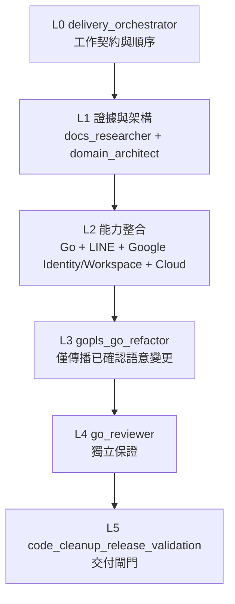

# Codex 專案 Agents 設計

本目錄 `.codex/agents/*.toml` 採用 [Codex custom agents 官方格式](https://learn.chatgpt.com/docs/agent-configuration/subagents)。各檔案必須包含 `name`、`description`、`developer_instructions`，並繼承主工作階段的 MCP、權限、供應商與工具。**Agent instructions 不是獨立的只讀沙盒或權限機制**。

## 層級與責任分工

這是**工作流與決策順序**，不是權限繼承樹：所有角色仍受主工作階段的 sandbox、工具與核准限制。`delivery_orchestrator` 只在跨領域工作建立順序與檔案所有權；主 Agent 保有整合與最後決策權。第 1 層的兩個角色可平行進行只讀查證；任何會修改相同檔案的工作必須串行。小型單一邊界工作直接交給相應角色。

| 層級 | Agent | 職責 | MCP 選擇 | 實作權限 |
|---|---|---|---|
| L0 | `delivery_orchestrator` | 跨領域工作契約、順序、檔案 owner 與驗收關卡 | AGENTS、Agent 設計、相關規範 | 只編排，不改程式／設定／部署 |
| L1 | `docs_researcher` | SDK／API／Codex 規格與 LINE Developers 文件來源 | SDK Catalog、gopls、Context7、OpenAI Docs、官方來源 | 只查證 |
| L1 | `domain_architect` | Bounded Context、Aggregate、Value Object、Port 邊界 | gopls | 預設設計分析 |
| L2 | `go_feature_engineer` | 一般 Go 的 Domain／Application 垂直切片 | gopls、Go 工具鏈、相關 skills | 被委派後可修改相應檔案 |
| L2 | `line_integrator` | LINE SDK v8：Webhook、Messaging、LIFF、token、audience、module、shop | gopls、Context7、LINE 官方來源 | 被委派後可修改相應檔案 |
| L2 | `google_identity_workspace_integrator` | Google OAuth／ID token、使用者 token、Calendar／Tasks／Forms 的每使用者存取 | gopls、Context7、Google 官方來源 | 被委派後可修改相應檔案；不可自行開 OAuth、部署或改 IAM |
| L2 | `cloud_platform` | Cloud Run、Firestore、Cloud Tasks、WIF、IAM | Context7，隔離 staging 才允許 Toolbox | 預設只審查；不可自行部署 |
| L3 | `gopls_go_refactor` | 跨 package rename、interface／DTO 演進、Port／Adapter 搬遷與語意批量修改 | gopls | 被委派後可修改 Go 檔案 |
| L4 | `go_reviewer` | Go correctness、Race、CI、PR 安全審查 | gopls、授權 GitHub（唯讀） | 只審查 |
| L4 | `go_architecture_reviewer` | DDD／六角形邊界、consumer ownership、結構冗餘的獨立審查 | gopls、架構測試 | 只審查 |
| L4 | `github_actions_reviewer` | GitHub Actions 的 trigger、權限、OIDC、secrets、cache／artifact 與 CI gate 審查 | GitHub MCP（本角色只讀）、workflow 原始碼 | 預設只審查 |
| L5 | `technical_docs_writer` | 技術文件、設定說明與可驗證 runbook | 程式／測試／第一方來源 | 被委派後可修改文件 |
| L5 | `go_agents_md_author` | AGENTS／Codex 規範與實際 Go 專案現況的一致性 | gopls、Go 工具鏈、codexcheck | 被委派後可修改規範文件 |
| L5 | `code_cleanup_release_validation` | 驗收後範圍檢查、引用追蹤、清理、受保護 SDK 及正式測試保留、發行驗證 | gopls、Go 工具鏈、CI、SDK Catalog | 經授權才可修改；不可自行合併或部署 |
| L5 | `cloud_run_release` | `line-bot-public`／`line-bot-private` 的受授權 Cloud Run 發布與證據 | Cloud Run release skill、Google 官方工具 | 明確授權後才可發布 |
| L5 | `git_release` | Git commit、branch、PR／merge 交付閘門與遠端驗證 | GitHub MCP、Git、Go 品質工具 | 明確授權後才可寫入；不可自行部署 |
| L1 | `openai_docs_researcher` | OpenAI 官方文件、API、SDK、Codex、Skills、MCP 與 Plugins 查證 | OpenAI Docs MCP；明確授權後可嘗試 Codex MCP setup；官方 fallback | 只查證，不修改產品程式 |

| L2 | `firestore_integrator` | Firestore persistence and consistency implementation specialist | gopls、Context7／相關官方文件（按需） | 依委派工作契約；預設不得操作 production |
| L2 | `cloud_tasks_integrator` | Cloud Tasks asynchronous execution, retry and idempotency specialist | gopls、Context7／相關官方文件（按需） | 依委派工作契約；預設不得操作 production |
| L4 | `security_reviewer` | Independent security and privacy reviewer for LINE, OAuth, Google Cloud and webhook trust boundaries | gopls、Context7／相關官方文件（按需） | 依委派工作契約；預設不得操作 production |
| L4 | `go_test_engineer` | Go test design and coverage specialist for behavioral, contract, integration, race and regression evidence | gopls、Context7／相關官方文件（按需） | 依委派工作契約；預設不得操作 production |
| L2 | `observability_engineer` | Production observability and diagnostic instrumentation specialist | gopls、Context7／相關官方文件（按需） | 依委派工作契約；預設不得操作 production |
| L4 | `performance_reviewer` | Read-only Go concurrency, latency, throughput and cloud-cost performance reviewer | gopls、Context7／相關官方文件（按需） | 依委派工作契約；預設不得操作 production |
| L4 | `api_contract_reviewer` | HTTP, webhook and external integration contract compatibility reviewer | gopls、Context7／相關官方文件（按需） | 依委派工作契約；預設不得操作 production |
| L2 | `data_migration_engineer` | Firestore and OAuth persistence migration specialist with rollback and compatibility gates | gopls、Context7／相關官方文件（按需） | 依委派工作契約；預設不得操作 production |
| L4 | `incident_responder` | Read-only production incident triage and recovery planning specialist | gopls、Context7／相關官方文件（按需） | 依委派工作契約；預設不得操作 production |
| L2/L3 | `architecture_alignment_engineer` | Evidence-driven repository realignment to DESIGN.md and DIRECTORY-STRUCTURE.md | gopls、Context7／相關官方文件（按需） | 依委派工作契約；預設不得操作 production |

Codex 內建 `worker`、`explorer` 可處理一般任務，不再額外建立通用 agent。主 Agent 負責拆分任務、避免併發編輯同一檔案、整合與最後驗證。只有實際互不依賴的工作才並行委派；建議最多三個子 Agent。

SDK 功能開發仍以 [sdk-integration Skill](../../.agents/skills/sdk-integration/SKILL.md) 按需查證。LINE 的十一個 v8 package 統一交 `line_integrator`，Google OAuth／Workspace 的八個 package 統一交 `google_identity_workspace_integrator`；不可依 import path 建立互相重疊的角色。兩者都必須將 SDK 型別留在 Adapter／Infrastructure、由 Bootstrap 組裝，並以自有 DTO／小型 Port 隔開 Domain 與 Application。`gopls_go_refactor` 專責 Go 語意批量修改，`code_cleanup_release_validation` 專責交付前清理與驗證。`go.mod` 預先核准的 SDK 直接依賴及其預留空白骨架不得因尚未使用被刪除，Catalog 的能力標籤只是搜尋提示。

## 使用範例

- 跨 LINE Account Linking、Google OAuth 與 Cloud Run：先由 `delivery_orchestrator` 產出串行工作契約；L1 定義證據與 DTO／Port，L2 分別實作 LINE、Google 與 IAM 邊界，必要時 L3 更新參照，再經 L4 審查和 L5 文件／交付驗證；只有明確授權時才交 `cloud_run_release`。
- 修改 Conversation 聚合：先由 `domain_architect` 釐清不變量，再交給內建 `worker` 實作；`go_reviewer` 審查。
- 新增 LINE Flex／Webhook event：由 `docs_researcher` 核對版本、`line_integrator` 實作、`go_reviewer` 驗證。
- 查 LINE 平台規格或文件差異：由 `docs_researcher` 讀取 [line-developers-docs-source](https://github.com/line/line-developers-docs-source) 與已發布的 LINE Developers 頁面，再交 `line_integrator` 依鎖定 SDK 實作；不另建重疊的文件 Agent。
- 新增每使用者 Google Calendar／Tasks／Forms：由 `domain_architect` 先定義自有 DTO／Port，`google_identity_workspace_integrator` 實作 BFF + PKCE、加密 token repository 與 SDK Adapter，`cloud_platform` 審查 public/private IAM 邊界，最後由 `go_reviewer` 驗證。
- LINE Account Linking 串接 Google 授權：`line_integrator` 處理 LINE webhook／link token，`google_identity_workspace_integrator` 處理 Google consent／connection；共用 Port 或 DTO 的演進先交 `gopls_go_refactor`，不可平行改同一檔案。
- 準備 Cloud Tasks Worker：`domain_architect` 釐清 Port、`cloud_platform` 審查 IAM 與資料一致性，主 Agent 排程實作。
- 判斷 SDK 升級：`docs_researcher` 核對正式來源，主 Agent 決定升級範圍。
- 將 application port 的 method 改名並更新所有 adapter、fake 與 call site：委派 `gopls_go_refactor`，先取得 references／implementations，再做語意批量修改與 diagnostics 驗證。
- 準備合併／交付：委派 `code_cleanup_release_validation`，先列出保留與候選清理項、檢查引用，再以 `codexcheck`、`make check`、Actions CI 驗證；不得刪除 SDK Reserved Modules／Scaffolds、必要 Regression Tests 或跳過真實 Staging 安全門檻。使用者明確授權 commit／push／PR／merge 後，再交 `git_release` 執行交付閘門與 GitHub MCP 遠端驗證。
- 修改 `.github/workflows`：先由 `github_actions_reviewer` 分析 trigger、權限與 WIF 邊界；修改一般 Go 垂直切片則由 `go_feature_engineer` 實作、`go_reviewer` 審查；修改 AGENTS／Codex 規範則交 `go_agents_md_author`。

## 禁止誤用

- `AGENTS.md` 是每次工作的規範；`.agents/skills/` 是工作流程；`.codex/agents/` 是角色；`.codex/config.toml` 才配置 MCP。這些不是同一種設定。
- 不要把 production 的 LINE 密鑰、Google ADC 或 GitHub PAT 放到 GitHub、TOML、skill 或 Agent instructions。
- MCP 寫入能力受外部帳號權限控制；即使 Agent 文本說「唯讀」，也不是技術隔離。正式環境權限需由 IAM／MCP allowlist 控制。
- Codex CLI／IDE 官方支援專案 Agent 檔；Codex Cloud 的工作階段是否載入該角色及 MCP 仍須在**已發布的雲端環境**實測，不以檔案存在保證。

## 架構對齊與新增專家路由（2026-11）

針對 `DESIGN.md` 與 `DIRECTORY-STRUCTURE.md` 的整體收斂，委派 `architecture_alignment_engineer` 先完成現況差異、依賴圖、可回復切片與驗收條件，不可直接大量移動檔案；跨 package 變更委派 `gopls_go_refactor`。兩份標靶對 Identity 目錄名稱不一致：`DESIGN.md` 明定 `value-objects/`，目錄圖寫 `valueobjects/`，在文件修正前以明確的 DESIGN Identity 契約為判斷依據，並在差異報告註明；不默默更動資料契約。

Firestore 實作交 `firestore_integrator`、Cloud Tasks 工作交 `cloud_tasks_integrator`、需要資料演進才交 `data_migration_engineer`、遙測實作交 `observability_engineer`。安全交 `security_reviewer`、測試設計與獨立測試檔交 `go_test_engineer`、效能交 `performance_reviewer`、HTTP/Webhook 契約交 `api_contract_reviewer`、事故診斷交 `incident_responder`。既有 `cloud_platform` 保持 IAM／Google Cloud 平台審查 owner，`go_reviewer` 保持最終 Go 正確性審查。

在受信任的 Codex 工作區，`.codex/config.toml` 使用 `[agents.<name>]` 與 `config_file = "agents/<name>.toml"` 註冊所有角色；註冊不是已啟動或已獲取外部服務權限。新增角色後同步更新 `cmd/codexcheck` 的允許名單與註冊檢查。
