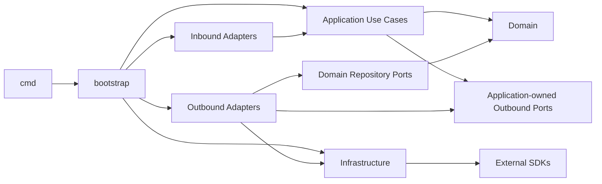
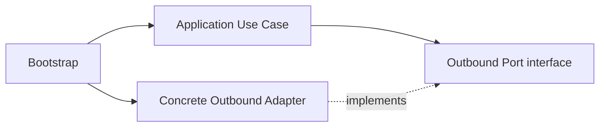
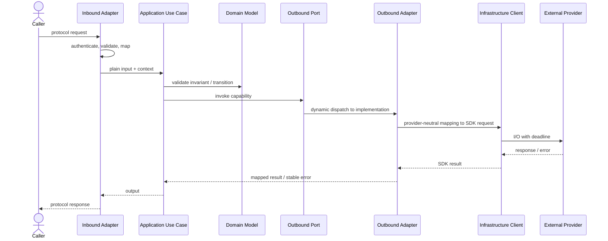
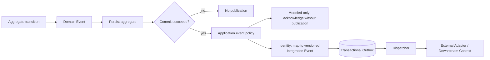

# Layer-first DDD + Hexagonal Architecture Blueprint

本文件是 [`DESIGN.md`](../../DESIGN.md) 的 repository-specific 閱讀投影，不建立第二份架構契約。若文字或圖示不一致，以 `DESIGN.md`、`AGENTS.md` 與 architecture tests 為準。

## Repository structure

本儲存庫採 layer-first modular monolith。Bounded Context 位於 Domain layer 內；Application capability、Adapters、Infrastructure 與 Bootstrap 分別保有單一責任。

```text
cmd/                                  # process entrypoints
internal/
  adapter/
    inbound/                          # HTTP, webhook, task and CLI drivers
    outbound/                         # Firestore, Cloud Tasks, LINE and Google adapters
  application/
    usecases/<capability>/            # orchestration, DTOs and consumer-owned ports
  domain/
    identity/                         # reference tactical DDD implementation
    <bounded-context>/                # aggregates, entities, value-objects, events, ... as needed
  infrastructure/                    # SDK clients, transports, auth, observability and lifecycle primitives
  bootstrap/                         # composition root; dependency assembly only
```

分類目錄只在具有 production consumer、實際行為與測試時建立。`internal/domain/identity` 是完整戰術元件的參考，但其他 Context 不必複製所有分類。不得用空目錄、空 interface 或 alias scaffold 表示完成度。

## Compile-time dependency

下圖的實線箭頭只代表 Go import／construction dependency，不代表 runtime call direction。



強制規則：

- Domain 只 import 標準庫與同一 Domain layer；不同 Bounded Context 不直接 import 對方內部模型。
- Application 只 import Application 與 Domain，不 import Adapter、Infrastructure 或第三方 SDK。
- Inbound Adapter 只依賴 Application contract／use case，不直接依賴 Domain、Outbound Adapter 或 Infrastructure。
- Outbound Adapter 實作 Application port 或 Domain repository port，並可使用 Infrastructure client。
- Infrastructure 不 import Domain、Application 或 Adapter，只提供可組裝的技術 primitives。
- Bootstrap 可建立具體依賴，但不擁有業務政策或 Aggregate transition。

Repository port 只有在表達 Aggregate persistence 語意時才由 Domain 擁有；provider、queue、publisher、SDK gateway 等工作流程能力由 consuming Application capability 擁有。同一能力不得同時存在兩份 contract。

## Interface implementation

Go interface satisfaction 是隱式的，不是 runtime call，也不是反向 import。下圖虛線代表 implements：



Interface 定義在 consumer 一側，Adapter 可以用 `var _ Port = (*Adapter)(nil)` 做 compile-time assertion。Constructor 通常回傳 concrete type；只有真正的變化或測試邊界才建立 interface。

## Runtime call

Runtime invocation 可以從核心向外執行，但這不改變上述 import direction：



## Domain Event and Integration Event

Domain Event 是 Bounded Context 內已發生的業務事實；Integration Event 是跨 Context 或外部系統使用的版本化契約。兩者不可直接視為同一 payload。



- Aggregate rehydration 不產生新事件。
- 外部發布只能在 aggregate 與 outbox 的 transaction commit 成功後發生。
- 跨 Context event 必須有穩定 event ID、type、schema version、occurred-at 與 idempotency key。
- Firestore transaction 只能保證本地 state/outbox 原子性；Cloud Tasks、LINE 或其他 provider 不具端到端 exactly-once 保證。
- Identity 將版本化 Integration Event 與 Aggregate state 寫入同一 transaction，並提供 commit 後使用的 dispatcher；因尚未指定 Integration Event sink，composition root 不會接上虛構 publisher，發布保持停用。
- Audience、Experience Presentation、Promotion 與 Workspace Automation 的事件本輪為 **modeled-not-published**：Aggregate save 成功後才 acknowledge；save 失敗時保留；不得將其誤寫為 outbox 或已部署發布能力。

## Production baseline and external verification

`production baseline` 表示儲存庫具備可測試的安全與可靠性機制，不等同於已完成 Staging／Production 驗收。

| Repository baseline | External verification |
| --- | --- |
| Explicit config validation | Authorized GCP project and IAM |
| LINE webhook signature verification | Real LINE test Channel and redelivery |
| Context propagation and bounded timeout | Cloud Run network and deadline behavior |
| Firestore Inbox/Outbox code and offline tests | Firestore TTL, index and emulator/staging transaction tests |
| Cloud Tasks OIDC verification code | Deployed queue, service account, audience and private ingress |
| Idempotency, lease and unknown-outcome states | Scheduler, alerting and manual recovery exercise |
| Structured, redacted logging | Monitoring/SLO and incident drill |
| Unit, contract, architecture and race tests | Load, rollback, backup/restore and disaster recovery evidence |

在右欄全部具備可追溯證據前，正確狀態是：

> Production baseline implemented; Staging/Production not verified.

不得以編譯成功、CI 綠燈、client factory 存在或 MCP／SDK 已設定，替代外部認證、授權、部署及運行驗收。

## Verification

```bash
go run ./cmd/domainmodel -mode=check
go test ./tests/architecture/...
go vet ./...
go test -race -count=1 ./...
go build ./...
```

這些命令驗證 repository state；它們不宣稱任何外部雲端或 LINE 環境已通過驗收。
