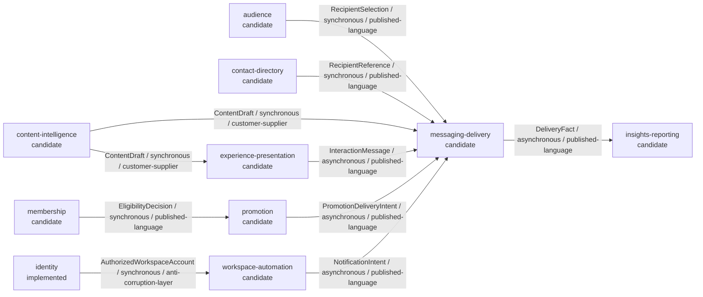

<!-- Code generated by domainmodel.RenderContextMap; DO NOT EDIT. -->

# Domain Context Map

## Subdomains

| Subdomain | Classification | Purpose |
|---|---|---|
| account-identity-and-authorization | supporting | Maintain verified account-link identity and authorization eligibility without owning credentials. |
| business-automation | supporting | Execute user-authorized business outcomes against replaceable workspace providers. |
| content-intelligence-subdomain | supporting | Produce reviewable content drafts through replaceable AI providers. |
| customer-experience | supporting | Coordinate presentation promotion and membership without merging their lifecycles. |
| customer-knowledge | supporting | Provide recipient references and derived insight without owning provider profiles or delivery decisions. |
| customer-segmentation | supporting | Define recipients independently from provider audience resources. |
| platform-commodities | generic | Supply replaceable persistence scheduling secrets storage transport identifiers and governance tooling without creating business Contexts. |
| reliable-customer-communication | core | Make customer communication reliable despite duplicate input and uncertain provider outcomes. |

## Contexts

| Context | Subdomain | Status | Decision | Confidence | Model | Classification | Owner |
|---|---|---|---|---|---|---|---|
| audience | customer-segmentation | candidate | hypothesis | medium | domain-model | supporting | unassigned |
| contact-directory | customer-knowledge | candidate | hypothesis | medium | read-model | supporting | unassigned |
| content-intelligence | content-intelligence-subdomain | candidate | hypothesis | low | process-model | supporting | unassigned |
| experience-presentation | customer-experience | candidate | hypothesis | low | domain-model | supporting | unassigned |
| identity | account-identity-and-authorization | implemented | implemented | high | domain-model | supporting | linebot-platform |
| insights-reporting | customer-knowledge | candidate | hypothesis | medium | read-model | supporting | unassigned |
| membership | customer-experience | candidate | hypothesis | low | read-model | supporting | unassigned |
| messaging-delivery | reliable-customer-communication | candidate | hypothesis | medium | domain-model | core | linebot-platform |
| promotion | customer-experience | candidate | hypothesis | low | domain-model | supporting | unassigned |
| workspace-automation | business-automation | candidate | hypothesis | medium | domain-model | supporting | linebot-platform |

## Aggregates and Data Ownership

| Context | Aggregate / Resource | Kind | Authority / Consistency Boundary | Owner |
|---|---|---|---|---|
| audience | AudienceDefinition | aggregate | Definition identity and selection criteria change together. | unassigned |
| audience | audience-definition | data | local-authoritative | audience |
| audience | provider-audience-membership | data | provider-authoritative | line-provider |
| contact-directory | provider-profile | data | provider-authoritative | line-provider |
| contact-directory | profile-projection | data | derived-projection | contact-directory |
| content-intelligence | generation-policy | data | local-authoritative | content-intelligence |
| content-intelligence | model-output | data | provider-authoritative | ai-provider |
| experience-presentation | InteractionSurface | aggregate | A surface version and its regions publish together. | unassigned |
| experience-presentation | desired-presentation | data | local-authoritative | experience-presentation |
| experience-presentation | deployed-provider-presentation | data | provider-authoritative | line-provider |
| identity | AccountLink | aggregate | Link connection status scopes and new events change atomically. | linebot-platform |
| identity | account-link-state | data | local-authoritative | identity |
| identity | oauth-credential-value | data | provider-authoritative | google-oauth |
| insights-reporting | delivery-facts | data | local-authoritative | messaging-delivery |
| insights-reporting | reporting-projection | data | derived-projection | insights-reporting |
| membership | membership-source-state | data | provider-authoritative | line-provider |
| membership | membership-projection | data | derived-projection | membership |
| messaging-delivery | Delivery | aggregate | Claim is single-use and completion accepts one terminal outcome. | linebot-platform |
| messaging-delivery | delivery-state | data | local-authoritative | messaging-delivery |
| messaging-delivery | provider-message-result | data | provider-authoritative | line-provider |
| promotion | Promotion | aggregate | Offer rules and lifecycle transition atomically. | unassigned |
| promotion | promotion-definition | data | local-authoritative | promotion |
| promotion | provider-coupon-state | data | provider-authoritative | line-provider |
| workspace-automation | AutomationRequest | aggregate | Intent approval and admission state change atomically. | linebot-platform |
| workspace-automation | automation-audit | data | local-authoritative | workspace-automation |
| workspace-automation | workspace-resource | data | provider-authoritative | google-workspace |

## Invariants

| Context | Invariant | Statement |
|---|---|---|
| audience | AUD-001 | A recipient selection is immutable once accepted by delivery. |
| contact-directory | CON-001 | A snapshot records observation time and never overwrites provider authority. |
| content-intelligence | CNT-001 | Generated output remains a draft until accepted by its consumer. |
| experience-presentation | EXP-001 | A published surface references a complete immutable presentation version. |
| identity | IDN-001 | A link requires valid LINE user Google subject and non-empty normalized scopes. |
| identity | IDN-002 | Google account identity is the stable subject claim and never an email. |
| identity | IDN-003 | Disconnect is idempotent and only its first transition raises AccountUnlinked. |
| insights-reporting | INS-001 | A metric snapshot identifies its period and source facts. |
| membership | MEM-001 | A projection cannot grant an entitlement absent from source facts. |
| messaging-delivery | MSG-001 | A delivery can be claimed for network send only once within its active lease. |
| messaging-delivery | MSG-002 | Transport ambiguity becomes unknown-outcome rather than known failure. |
| promotion | PRO-001 | A closed promotion cannot issue a new delivery intent. |
| workspace-automation | WSA-001 | No action executes without an eligible account and required scope. |

## Relationships

## Ubiquitous Language

| Context | Term | Definition |
|---|---|---|
| audience | audience-definition | Stable criteria for selecting recipients. |
| audience | audience-sync | Process aligning a definition with provider representation. |
| audience | recipient-selection | Immutable result consumed by delivery. |
| contact-directory | profile-snapshot | Time-stamped observation of provider profile data. |
| contact-directory | recipient-reference | Stable reference usable by delivery. |
| content-intelligence | content-draft | Unapproved generated output returned to a consumer. |
| content-intelligence | generation-request | Provider-independent request constrained by consumer policy. |
| experience-presentation | interaction-surface | Versioned desired interactive presentation. |
| experience-presentation | presentation-asset | Referenced media used by a surface. |
| experience-presentation | surface-assignment | Intent to expose a surface to selected recipients. |
| identity | account-link | Relationship between one validated LINE user and one verified Google subject. |
| identity | account-linked | Fact raised when a verified account relationship is created. |
| identity | account-unlinked | Fact raised only for the first successful disconnect. |
| identity | connection | Authorization relationship with scopes and lifecycle status. |
| identity | google-account | Google identity represented by its verified stable subject claim. |
| insights-reporting | delivery-fact | Immutable fact emitted by Messaging Delivery. |
| insights-reporting | metric-snapshot | Derived metric for a defined reporting period. |
| membership | entitlement-view | Derived benefits visible to a consumer. |
| membership | membership-status | Observed membership state at a point in time. |
| messaging-delivery | delivery | Consistency boundary for claim and terminal outcome. |
| messaging-delivery | delivery-event | Modeled fact raised by an in-memory Delivery transition; the current workflow does not persist, acknowledge, or publish it. |
| messaging-delivery | delivery-intent | Request to deliver content to a resolved recipient. |
| messaging-delivery | idempotency-key | Stable identity preventing duplicate business delivery. |
| messaging-delivery | unknown-outcome | Send whose remote effect cannot be safely determined. |
| promotion | eligibility-decision | Decision whether a subject may receive an offer. |
| promotion | promotion | Time-bounded offer with an explicit lifecycle. |
| promotion | promotion-delivery-intent | Approved promotion content prepared for delivery. |
| workspace-automation | automation-request | User-authorized intent to produce a business outcome. |
| workspace-automation | execution-outcome | Recorded result including unknown remote outcome. |
| workspace-automation | workspace-action | Provider-independent action within an approved request. |

## Endpoint Capabilities

| Operation | Status | Capability | Context | Implementation |
|---|---|---|---|---|
| addAudienceToAudienceGroup | provisional | audience-management | audience | internal/application/usecases/audience |
| addUserIdsToAudience | provisional | audience-management | audience | internal/application/usecases/audience |
| broadcast | mapped | message-delivery | messaging-delivery | internal/application/usecases/messaging-delivery |
| cancelDefaultRichMenu | provisional | experience-presentation | experience-presentation | internal/application/usecases/experience-presentation |
| closeCoupon | provisional | promotion-management | promotion | internal/application/usecases/promotion |
| createAudienceForUploadingUserIds | provisional | audience-management | audience | internal/application/usecases/audience |
| createAudienceGroup | provisional | audience-management | audience | internal/application/usecases/audience |
| createClickBasedAudienceGroup | provisional | audience-management | audience | internal/application/usecases/audience |
| createCoupon | provisional | promotion-management | promotion | internal/application/usecases/promotion |
| createImpBasedAudienceGroup | provisional | audience-management | audience | internal/application/usecases/audience |
| createRichMenu | provisional | experience-presentation | experience-presentation | internal/application/usecases/experience-presentation |
| createRichMenuAlias | provisional | experience-presentation | experience-presentation | internal/application/usecases/experience-presentation |
| deleteAudienceGroup | provisional | audience-management | audience | internal/application/usecases/audience |
| deleteRichMenu | provisional | experience-presentation | experience-presentation | internal/application/usecases/experience-presentation |
| deleteRichMenuAlias | provisional | experience-presentation | experience-presentation | internal/application/usecases/experience-presentation |
| getAggregationUnitNameList | unclassified | pending-business-classification | Not Verified | internal/application/usecases/provider-configuration |
| getAggregationUnitUsage | unclassified | pending-business-classification | Not Verified | internal/application/usecases/provider-configuration |
| getAudienceData | provisional | audience-management | audience | internal/application/usecases/audience |
| getAudienceGroups | provisional | audience-management | audience | internal/application/usecases/audience |
| getBotInfo | not-domain-relevant | provider-boundary-operation | Not Verified | internal/application/usecases/provider-configuration |
| getCouponDetail | provisional | promotion-management | promotion | internal/application/usecases/promotion |
| getDefaultRichMenuId | provisional | experience-presentation | experience-presentation | internal/application/usecases/experience-presentation |
| getFollowers | unclassified | pending-business-classification | Not Verified | internal/application/usecases/contact-directory |
| getFriendsDemographics | mapped | communication-insights | Not Verified | internal/application/usecases/insights-reporting |
| getGroupMemberCount | mapped | contact-directory | Not Verified | internal/application/usecases/contact-directory |
| getGroupMemberProfile | mapped | contact-directory | Not Verified | internal/application/usecases/contact-directory |
| getGroupMembersIds | mapped | contact-directory | Not Verified | internal/application/usecases/contact-directory |
| getGroupSummary | mapped | contact-directory | Not Verified | internal/application/usecases/contact-directory |
| getJoinedMembershipUsers | provisional | membership-inspection | membership | internal/application/usecases/membership |
| getMembershipList | provisional | membership-inspection | membership | internal/application/usecases/membership |
| getMembershipSubscription | provisional | membership-inspection | membership | internal/application/usecases/membership |
| getMessageContent | not-domain-relevant | provider-boundary-operation | Not Verified | internal/application/usecases/media-transfer |
| getMessageContentPreview | not-domain-relevant | provider-boundary-operation | Not Verified | internal/application/usecases/media-transfer |
| getMessageContentTranscodingByMessageId | not-domain-relevant | provider-boundary-operation | Not Verified | internal/application/usecases/media-transfer |
| getMessageEvent | mapped | communication-insights | Not Verified | internal/application/usecases/insights-reporting |
| getMessageQuota | provisional | delivery-observability | messaging-delivery | internal/application/usecases/provider-configuration |
| getMessageQuotaConsumption | provisional | delivery-observability | messaging-delivery | internal/application/usecases/provider-configuration |
| getNarrowcastProgress | provisional | delivery-observability | messaging-delivery | internal/application/usecases/provider-configuration |
| getNumberOfFollowers | mapped | communication-insights | Not Verified | internal/application/usecases/insights-reporting |
| getNumberOfMessageDeliveries | mapped | communication-insights | Not Verified | internal/application/usecases/insights-reporting |
| getNumberOfSentBroadcastMessages | provisional | delivery-observability | messaging-delivery | internal/application/usecases/insights-reporting |
| getNumberOfSentMulticastMessages | provisional | delivery-observability | messaging-delivery | internal/application/usecases/insights-reporting |
| getNumberOfSentPushMessages | provisional | delivery-observability | messaging-delivery | internal/application/usecases/insights-reporting |
| getNumberOfSentReplyMessages | provisional | delivery-observability | messaging-delivery | internal/application/usecases/insights-reporting |
| getPNPMessageStatistics | provisional | delivery-observability | messaging-delivery | internal/application/usecases/insights-reporting |
| getPNPTemplatedMessageStatistics | provisional | delivery-observability | messaging-delivery | internal/application/usecases/insights-reporting |
| getProfile | mapped | contact-directory | Not Verified | internal/application/usecases/contact-directory |
| getRichMenu | provisional | experience-presentation | experience-presentation | internal/application/usecases/experience-presentation |
| getRichMenuAlias | provisional | experience-presentation | experience-presentation | internal/application/usecases/experience-presentation |
| getRichMenuAliasList | provisional | experience-presentation | experience-presentation | internal/application/usecases/experience-presentation |
| getRichMenuBatchProgress | provisional | experience-presentation | experience-presentation | internal/application/usecases/experience-presentation |
| getRichMenuIdOfUser | provisional | experience-presentation | experience-presentation | internal/application/usecases/experience-presentation |
| getRichMenuImage | not-domain-relevant | provider-boundary-operation | Not Verified | internal/application/usecases/media-transfer |
| getRichMenuInsightDaily | mapped | communication-insights | Not Verified | internal/application/usecases/insights-reporting |
| getRichMenuInsightSummary | mapped | communication-insights | Not Verified | internal/application/usecases/insights-reporting |
| getRichMenuList | provisional | experience-presentation | experience-presentation | internal/application/usecases/experience-presentation |
| getRoomMemberCount | mapped | contact-directory | Not Verified | internal/application/usecases/contact-directory |
| getRoomMemberProfile | mapped | contact-directory | Not Verified | internal/application/usecases/contact-directory |
| getRoomMembersIds | mapped | contact-directory | Not Verified | internal/application/usecases/contact-directory |
| getSharedAudienceData | provisional | audience-management | audience | internal/application/usecases/audience |
| getSharedAudienceGroups | provisional | audience-management | audience | internal/application/usecases/audience |
| getStatisticsPerUnit | mapped | communication-insights | Not Verified | internal/application/usecases/insights-reporting |
| getWebhookEndpoint | not-domain-relevant | provider-boundary-operation | Not Verified | internal/application/usecases/provider-configuration |
| getsAllValidChannelAccessTokenKeyIds | not-domain-relevant | provider-boundary-operation | Not Verified | internal/application/usecases/credential-lifecycle |
| issueChannelToken | not-domain-relevant | provider-boundary-operation | Not Verified | internal/application/usecases/credential-lifecycle |
| issueChannelTokenByJWT | not-domain-relevant | provider-boundary-operation | Not Verified | internal/application/usecases/credential-lifecycle |
| issueLinkToken | unclassified | pending-business-classification | Not Verified | internal/application/usecases/account-link-token |
| issueStatelessChannelToken | not-domain-relevant | provider-boundary-operation | Not Verified | internal/application/usecases/credential-lifecycle |
| leaveGroup | mapped | message-delivery | messaging-delivery | internal/application/usecases/conversation-operations |
| leaveRoom | mapped | message-delivery | messaging-delivery | internal/application/usecases/conversation-operations |
| linkRichMenuIdToUser | provisional | experience-presentation | experience-presentation | internal/application/usecases/experience-presentation |
| linkRichMenuIdToUsers | provisional | experience-presentation | experience-presentation | internal/application/usecases/experience-presentation |
| listCoupon | provisional | promotion-management | promotion | internal/application/usecases/promotion |
| markMessagesAsRead | unclassified | pending-business-classification | Not Verified | internal/application/usecases/conversation-operations |
| markMessagesAsReadByToken | unclassified | pending-business-classification | Not Verified | internal/application/usecases/conversation-operations |
| multicast | mapped | message-delivery | messaging-delivery | internal/application/usecases/messaging-delivery |
| narrowcast | mapped | message-delivery | messaging-delivery | internal/application/usecases/messaging-delivery |
| pushMessage | mapped | message-delivery | messaging-delivery | internal/application/usecases/messaging-delivery |
| pushMessagesByPhone | mapped | message-delivery | messaging-delivery | internal/application/usecases/messaging-delivery |
| pushTemplatedMessagesByPhone | mapped | message-delivery | messaging-delivery | internal/application/usecases/messaging-delivery |
| replyMessage | mapped | message-delivery | messaging-delivery | internal/application/usecases/messaging-delivery |
| revokeChannelToken | not-domain-relevant | provider-boundary-operation | Not Verified | internal/application/usecases/credential-lifecycle |
| revokeChannelTokenByJWT | not-domain-relevant | provider-boundary-operation | Not Verified | internal/application/usecases/credential-lifecycle |
| richMenuBatch | provisional | experience-presentation | experience-presentation | internal/application/usecases/experience-presentation |
| setDefaultRichMenu | provisional | experience-presentation | experience-presentation | internal/application/usecases/experience-presentation |
| setRichMenuImage | not-domain-relevant | provider-boundary-operation | Not Verified | internal/application/usecases/media-transfer |
| setWebhookEndpoint | not-domain-relevant | provider-boundary-operation | Not Verified | internal/application/usecases/provider-configuration |
| showLoadingAnimation | unclassified | pending-business-classification | Not Verified | internal/application/usecases/conversation-operations |
| testWebhookEndpoint | not-domain-relevant | provider-boundary-operation | Not Verified | internal/application/usecases/provider-configuration |
| unlinkRichMenuIdFromUser | provisional | experience-presentation | experience-presentation | internal/application/usecases/experience-presentation |
| unlinkRichMenuIdFromUsers | provisional | experience-presentation | experience-presentation | internal/application/usecases/experience-presentation |
| updateAudienceGroupDescription | provisional | audience-management | audience | internal/application/usecases/audience |
| updateRichMenuAlias | provisional | experience-presentation | experience-presentation | internal/application/usecases/experience-presentation |
| validateBroadcast | not-domain-relevant | provider-boundary-operation | Not Verified | internal/application/usecases/request-validation |
| validateMulticast | not-domain-relevant | provider-boundary-operation | Not Verified | internal/application/usecases/request-validation |
| validateNarrowcast | not-domain-relevant | provider-boundary-operation | Not Verified | internal/application/usecases/request-validation |
| validatePush | not-domain-relevant | provider-boundary-operation | Not Verified | internal/application/usecases/request-validation |
| validateReply | not-domain-relevant | provider-boundary-operation | Not Verified | internal/application/usecases/request-validation |
| validateRichMenuBatchRequest | not-domain-relevant | provider-boundary-operation | Not Verified | internal/application/usecases/experience-presentation |
| validateRichMenuObject | not-domain-relevant | provider-boundary-operation | Not Verified | internal/application/usecases/experience-presentation |
| verifyChannelToken | not-domain-relevant | provider-boundary-operation | Not Verified | internal/application/usecases/credential-lifecycle |
| verifyChannelTokenByJWT | not-domain-relevant | provider-boundary-operation | Not Verified | internal/application/usecases/credential-lifecycle |

## Go Module Capability Evidence

| Module | Version | SDK status | Classification | Capabilities | Context signals |
|---|---|---|---|---|---|
| cloud.google.com/go/cloudtasks | v1.21.1 | integrated | generic-infrastructure | durable-background-work, oidc-worker, bounded-task-deduplication | Not Verified |
| cloud.google.com/go/firestore | v1.29.2 | integrated | generic-infrastructure | transactions, durable-inbox-outbox, persistence | Not Verified |
| cloud.google.com/go/secretmanager | v1.23.1 | client_ready | generic-infrastructure | secret-access | Not Verified |
| cloud.google.com/go/storage | v1.70.0 | client_ready | generic-infrastructure | object-upload, object-download | Not Verified |
| github.com/BurntSushi/toml | v1.6.0 | integrated | tooling | toml-parse, configuration-validation | Not Verified |
| github.com/google/uuid | v1.6.0 | integrated | generic-infrastructure | uuid-v4, retry-key-generation | Not Verified |
| github.com/line/line-bot-sdk-go/v8 | v8.23.0 | integrated | domain-signal | webhook, messaging, audiences, presentation, promotion, membership, analytics | messaging-delivery, audience, experience-presentation, promotion, membership, contact-directory, insights-reporting |
| github.com/modelcontextprotocol/go-sdk | v1.8.0 | client_ready | generic-infrastructure | tool-discovery, tool-invocation | Not Verified |
| github.com/openai/openai-go/v3 | v3.91.1 | client_ready | supporting-capability | ai-text-generation, responses-api | content-intelligence |
| go.linecorp.com/garr | v0.1.1 | declared | generic-infrastructure | retry, circuit-breaker | Not Verified |
| go.opentelemetry.io/contrib/detectors/gcp | v1.45.0 | integrated | generic-infrastructure | gcp-resource-detection | Not Verified |
| go.opentelemetry.io/otel | v1.47.0 | integrated | generic-infrastructure | trace-context, telemetry-api | Not Verified |
| go.opentelemetry.io/otel/exporters/otlp/otlpmetric/otlpmetricgrpc | v1.47.0 | integrated | generic-infrastructure | otlp-metric-export | Not Verified |
| go.opentelemetry.io/otel/exporters/otlp/otlptrace/otlptracegrpc | v1.47.0 | integrated | generic-infrastructure | otlp-trace-export | Not Verified |
| go.opentelemetry.io/otel/metric | v1.47.0 | integrated | generic-infrastructure | metric-instrumentation | Not Verified |
| go.opentelemetry.io/otel/sdk | v1.47.0 | integrated | generic-infrastructure | trace-provider, sampling | Not Verified |
| go.opentelemetry.io/otel/sdk/metric | v1.47.0 | integrated | generic-infrastructure | meter-provider, periodic-metric-reader | Not Verified |
| go.opentelemetry.io/otel/trace | v1.47.0 | integrated | generic-infrastructure | span-instrumentation | Not Verified |
| go.yaml.in/yaml/v3 | v3.0.5 | integrated | tooling | strict-yaml-validation, governance-manifests | Not Verified |
| golang.org/x/oauth2 | v0.37.0 | integrated | supporting-capability | authorization-code-pkce, token-source | identity, workspace-automation |
| google.golang.org/api | v0.310.0 | client_ready | supporting-capability | drive, sheets, calendar, tasks, forms | workspace-automation |
| google.golang.org/genai | v1.77.0 | client_ready | supporting-capability | gemini, vertex-ai, ai-text-generation | content-intelligence |
| google.golang.org/grpc | v1.84.0 | integrated | generic-infrastructure | cloud-api-status, error-translation | Not Verified |
